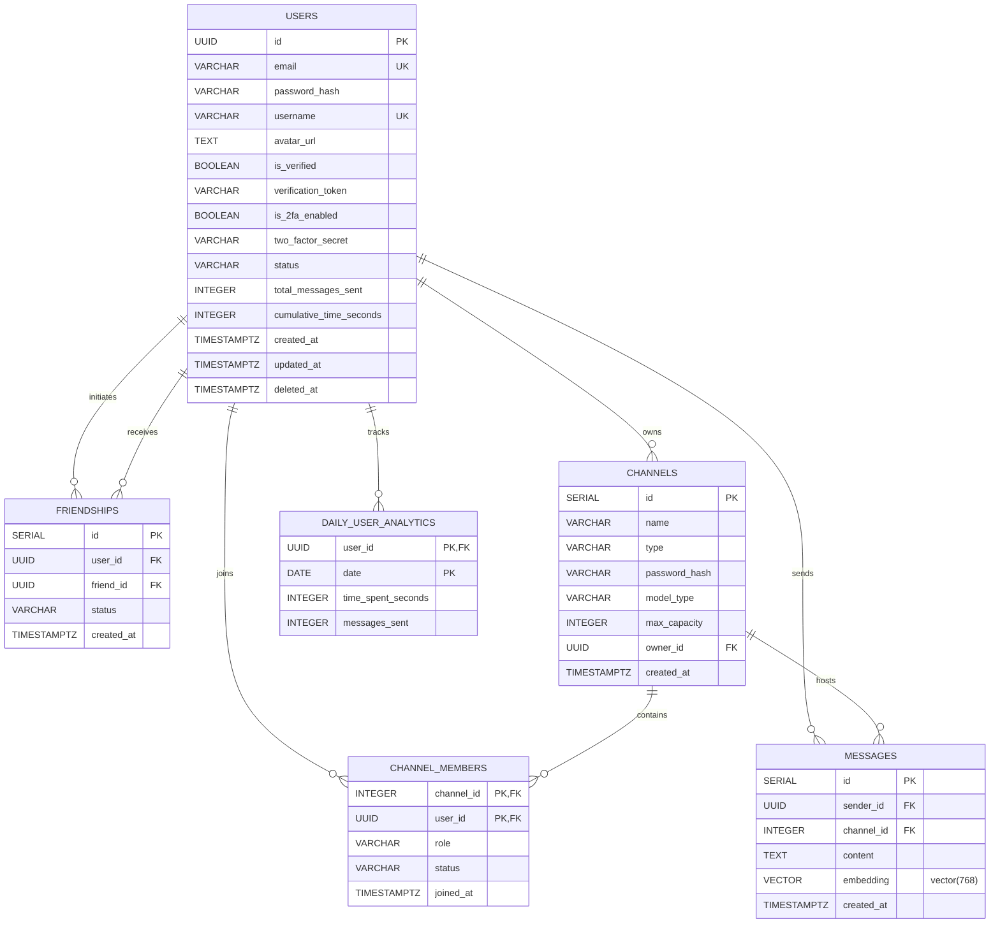

_This project has been created as part of the 42 curriculum by juljin, ksilvest, nlienard, dinza-cr._

# ft_transcendence

## Description
**ft_cluster** is a web-based **3D Coworking and Study Space**. We built this project to provide a collaborative virtual environment where users can work together in real-time. The core features include an interactive 3D room, a live chat system, user profiles with friend management, third-party OAuth logins, and an integrated AI chatbot to help answer questions while you study.

## Modules

### Web
- **[Major - 2pts] Frameworks: Next.js and FastAPI**
  - *Justification:* Chosen to establish a robust, decoupled architecture.
  - *Implementation:* Next.js (React) for the frontend UI and Python FastAPI for the AI microservice.
  - *Team:* nlienard, ksilvest
- **[Major - 2pts] Real-time WebSockets**
  - *Justification:* Essential for synchronizing user presence in the 3D space.
  - *Implementation:* Built a Go WebSocket hub using the Gorilla library to broadcast spatial data.
  - *Team:* juljin
- **[Major - 2pts] User Interaction**
  - *Justification:* Necessary to build a community-driven platform.
  - *Implementation:* Engineered a live chat, profile CRUD, and a bidirectional Postgres friendship system.
  - *Team:* juljin, nlienard

### Accessibility & Internationalization
- **[Minor - 1pt] Support for additional browsers**
  - *Justification:* A study space should work for everyone in the room, whatever browser they use, not just in Chrome.
  - *Implementation:* Every feature was tested and fixed in Chrome, Firefox and Safari, with the same UI in each. Browser-specific CSS has standard fallbacks (e.g. `scrollbar-width`/`scrollbar-color` for Firefox alongside the `::-webkit-scrollbar` styles). Known limitations: [TBD - list any, or write "none found"].
  - *Team:* juljin, ksilvest, dinza-cr, nlienard

### User Management
- **[Major - 2pts] Standard Authentication**
  - *Justification:* Required to securely isolate user data and sessions.
  - *Implementation:* Developed a secure JWT architecture with Resend API email verification and avatar uploads.
  - *Team:* juljin, nlienard
- **[Minor - 1pt] Remote Authentication (OAuth 2.0)**
  - *Justification:* Chosen to provide frictionless onboarding for new users.
  - *Implementation:* Built a dynamic, state-protected OAuth pipeline for 42 Intra, Google, and GitHub.
  - *Team:* juljin
- **[Minor - 1pt] Two-Factor Authentication (2FA)**
  - *Justification:* Protects accounts even when a password or an OAuth provider account is compromised.
  - *Implementation:* TOTP (RFC 6238) codes from any authenticator app, enforced on both password and OAuth logins, with short-lived pending tokens and per-login attempt limits.
  - *Team:* juljin
- **[Minor - 1pt] User analytics and insights dashboard**
  - *Justification:* Lets users see how much they actually study and interact in the space, which fits a productivity-focused coworking app.
  - *Implementation:* The backend records time spent in rooms (saved when a user leaves, disconnects or is removed from a room) and messages sent, both as lifetime totals on the user and per day in a `daily_user_analytics` table. A `GET /profile/analytics` endpoint returns that per-day data for the last 7 or 30 days, with empty days filled in as zeros. The profile dashboard shows the lifetime totals and two bar charts (messages sent per day, time spent per day) with a 7/30-day switch and per-day tooltips on hover or keyboard focus. The charts are visible only on the user's own profile.
  - *Team:* juljin, dinza-cr, nlienard

### Artificial Intelligence
- **[Major - 2pts] LLM Interface**
  - *Justification:* To provide users with an interactive, on-demand study assistant.
  - *Implementation:* Created a Python streaming API powered by the Google Gemini SDK.
  - *Team:* ksilvest
- **[Major - 2pts] Retrieval-Augmented Generation (RAG)**
  - *Justification:* Ground AI responses in contextual workspace data using pgvector semantic search.
  - *Implementation:* Built a RAG pipeline utilizing pgvector for vector cosine search and dataset export. Every chat message gets a 768-dimension Gemini embedding, searched by cosine distance through an HNSW index, and messages from users mentioned by name in the question are added to the context. The assistant requires login: the AI service verifies the session token issued by the Go backend (same `JWT_SECRET`), and both searches only cover rooms and DMs the asking user belongs to, so it can never reveal someone else's conversations.
  - *Team:* ksilvest

### Gaming & User Experience
- **[Major - 2pts] Advanced 3D Graphics**
  - *Justification:* Chosen to foster collaboration over competition. Demonstrates severe technical complexity via WebGL lifecycle management.
  - *Implementation:* Designed custom Blender `.glb` assets, rendered via native Three.js inside React with interactive raycasting.
  - *Team:* dinza-cr

### Data and Analytics
- **[Minor - 1pt] GDPR Compliance**
  - *Justification:* Users share personal data with us (email, avatar, messages, friends, activity), so they should be able to see all of it and erase it, as the GDPR requires.
  - *Implementation:* A "Your data" section on the profile. **Export** (`GET /profile/export`) downloads all of the user's data as a readable JSON file (profile, friends, rooms, memberships, messages, daily activity), leaving out secrets like the password hash and 2FA secret. **Delete** (`DELETE /profile/delete`) asks the user to type their username, checked on the backend too, then erases the account in one transaction: messages, friendships, owned rooms, memberships and analytics are deleted, and the email, password, avatar and 2FA data are wiped, leaving only an anonymous `deleted_…` placeholder. Both operations send a confirmation email through Resend. Logging out or deleting the account also clears the AI assistant conversation stored in the browser, and the privacy policy page explains what is collected and how to use these rights.
  - *Team:* juljin

### Modules of Choice
- **[Minor - 1pt] Day / Night Environment**
  - *Why we chose it:* People study at every hour of the day, so the workspace should be comfortable to use late at night. Instead of only darkening the interface, we change the lighting of the whole 3D room.
  - *Technical challenges:*
    - **Two sets of baked lighting:** the room's lighting is baked in Blender twice, once for day and once for night, and exported as two texture sets compressed to WebP (≈4.2 MB day, ≈2.8 MB night).
    - **Smooth transition:** a custom shader is added to Three.js's built-in materials (`onBeforeCompile`) so they draw both texture sets and fade between them, with eased timing over 1 s while the background colour changes with them. Users who ask for reduced motion get an instant switch.
    - **Loading and memory:** both sets are downloaded once when the room loads, sent to the GPU in advance (`renderer.initTexture`) and cached, so switching never stutters. A failed download shows an error message instead of breaking the scene, and every texture is freed when the scene closes.
  - *Value to the project:* The 3D room and the interface (colour theme, panels, room controls) switch together from one toggle, so the whole app changes, not just the page colours.
  - *Why it is a Minor:* It builds on the existing 3D scene rather than adding a new system, but it needed its own work in Blender, a custom shader and careful texture handling, which is well beyond a CSS theme toggle.
  - *Team:* dinza-cr

### Point Calculation
| Module | Category | Type | Points |
|---|---|:---:|---:|
| Frameworks: Next.js and FastAPI | Web | Major | 2 |
| Real-time WebSockets | Web | Major | 2 |
| User Interaction | Web | Major | 2 |
| Support for additional browsers | Accessibility & Internationalization | Minor | 1 |
| Standard Authentication | User Management | Major | 2 |
| Remote Authentication (OAuth 2.0) | User Management | Minor | 1 |
| Two-Factor Authentication (2FA) | User Management | Minor | 1 |
| User analytics and insights dashboard | User Management | Minor | 1 |
| LLM Interface | Artificial Intelligence | Major | 2 |
| Retrieval-Augmented Generation (RAG) | Artificial Intelligence | Major | 2 |
| Advanced 3D Graphics | Gaming & User Experience | Major | 2 |
| GDPR Compliance | Data and Analytics | Minor | 1 |
| Day / Night Environment | Modules of Choice | Minor | 1 |
| **Total** | | **7 Majors + 6 Minors** | **20** |

**20 points** claimed (Major = 2 pts, Minor = 1 pt): 14 mandatory + 5 bonus, which is the bonus maximum, plus 1 point of margin in case a module is not validated.

## Features List
* **Authentication:** Secure JWT-based session management, Resend Email Verification, and robust Multi-Provider OAuth 2.0 (Google, GitHub, 42 Intra) featuring a smart auto-incrementing username resolver for collision prevention. *(By juljin, nlienard)*
* **Two-Factor Authentication:** Optional TOTP 2FA with QR code setup for any authenticator app (Google Authenticator, Authy, 1Password...). Once enabled, every login (password or OAuth) requires a 6-digit code; pending login tokens expire after 5 minutes and lock after 5 wrong codes. *(By juljin)*
* **Real-Time Presence & Chat:** Gorilla WebSocket architecture with Ping/Pong heartbeats, real-time presence tracking (ONLINE/OFFLINE), Ghost-Avatar auto-cleanup, and spatial anti-cheat DB validation. *(By juljin, nlienard)*
* **Direct Messaging:** Private, omnipresent 1-on-1 chats elegantly architected on top of the existing spatial channel infrastructure. *(By juljin, nlienard)*
* **User Management:** Full CRUD operations for user profiles, settings, and avatars. *(By juljin, nlienard)*
* **Activity Dashboard:** Lifetime totals plus daily bar charts of messages sent and time spent in rooms, over the last 7 or 30 days. *(By juljin, dinza-cr, nlienard)*
* **Privacy & GDPR:** Download all your data as JSON, or permanently erase your account and its personal data after typing your username, with a confirmation email for each. *(By juljin)*
* **Legal Pages:** Privacy Policy and Terms of Service written for this project, linked from the footer of every page and from the signup form. *(By juljin)*
* **Input Validation:** Every form is checked on the frontend and again with the same rules on the backend (usernames, emails, password strength, room names and passwords, 500-character messages and AI prompts), plus a size limit on WebSocket frames. *(By juljin)*
* **Social Network:** Bidirectional friend request system (Add, Accept, Deny, Remove). *(By juljin, nlienard)*
* **AI Assistant (Kewan AI):** Integration of a real-time, streaming conversational agent powered by the Google Gemini SDK, pgvector-backed semantic RAG search, and an interactive window UI (`KewanWindow`) featuring smooth entrance animations, window dragging, and markdown rendering. Requires login and only draws context from the user's own rooms and DMs. *(By ksilvest, juljin)*
* **3D Workspace:** An interactive 3D virtual environment built with native Three.js, featuring custom `.glb` models, interactive raycasting, smooth mouse-follow camera mechanics, and dynamic React window UI overlays for 3D object click interactions. *(By dinza-cr)*

## Instructions

### Prerequisites
Before running the project, ensure you have the following software installed:
* **Docker** (v24.0 or higher)
* **Docker Compose** (v2.0 or higher)
* **Git**

### Installation & Configuration
1. Clone the repository and navigate into it:
   ```bash
   git clone <repository_url>
   cd ft_transcendence
   ```
2. Copy the environment template:
   ```bash
   cp .env.example .env
   ```
3. Fill in the required credentials inside `.env`:
   * **Database:** Set a secure `POSTGRES_USER` and `POSTGRES_PASSWORD`.
   * **Sessions:** Set `JWT_SECRET` to a long random string (e.g. `openssl rand -hex 32`). The backend signs session tokens with it and the AI service uses it to check who is asking, so nobody can log in or use the assistant without it.
   * **Port:** The app is served on `HTTPS_PORT` (`8443` by default) because rootless Podman, which `docker` may be an alias for, cannot use ports below 1024. Keep `FRONTEND_URL` on the same port (`https://localhost:8443`), since email links and OAuth redirects are built from it.
   * **AI Chatbot:** Provide a `GOOGLE_API_KEY` for the Gemini SDK.
   * **Email Verification:** Provide a `RESEND_API_KEY`.
   * **OAuth Providers (If testing remote login):** Provide Client IDs and Secrets for Google, GitHub, and 42 Intra.
   * **Two-Factor Authentication:** No configuration needed. Codes are computed locally by the authenticator app, so 2FA works on `localhost` without any external service.

### Execution
1. Boot the entire infrastructure:
   ```bash
   make up
   ```
   *(Alternatively, run `docker compose up --build -d`)*
2. Open your browser and navigate to **`https://localhost:8443`**.
   > *Note: Because we use self-signed SSL certificates, your browser will warn you that the connection is not private. Click "Advanced" -> "Proceed to localhost".*
3. Only NGINX is reachable from outside Docker. To inspect the database or run the dataset scripts, go through the containers:
   ```bash
   docker compose exec database psql -U <POSTGRES_USER> -d <POSTGRES_DB>
   docker compose exec ai-service python import_dataset.py
   ```

## Technical Stack
* **Frontend:** Next.js (React), TypeScript, Tailwind CSS
  * *Justification:* Next.js was chosen for its App Router architecture and built-in API proxying, allowing us to safely route authenticated requests into our internal Docker network without exposing ports.
* **Frontend (3D):** Native Three.js
  * *Justification:* Native Three.js was strictly chosen over abstraction wrappers (like React Three Fiber) to maintain absolute, low-level control over the WebGL rendering lifecycle, memory management, and garbage collection during React unmounts.
* **Backend:** Go (1.27.1), net/http standard library, Gorilla WebSockets
  * *Justification:* Go was strictly chosen for its concurrency model (Goroutines), which allows us to efficiently manage hundreds of simultaneous real-time WebSocket connections and ping/pong heartbeats with virtually zero latency.
* **Backend (AI Service):** Python 3.12, FastAPI, Google GenAI SDK
  * *Justification:* Python is the industry standard for AI. FastAPI provides asynchronous request handling (`async/await`), which is crucial for streaming large LLM text chunks back to the user in real-time.
* **Database:** PostgreSQL 17 with the pgvector extension (`pgvector/pgvector:pg17` image), pgx/v5 driver (Go), asyncpg (Python)
  * *Justification:* PostgreSQL was chosen for its unmatched ACID compliance and advanced relational indexing. Because our app relies on a complex Bidirectional Friendship system and strict spatial anti-cheat validations, we required a rigid, schema-enforced relational database rather than a NoSQL document store.
  * *Why pgvector:* The RAG assistant needs to find chat messages by meaning, not just by keywords. pgvector stores each message's Gemini embedding (a 768-dimension vector) in a column right next to the message and searches it by cosine distance through an HNSW index. Keeping vectors in PostgreSQL instead of a separate vector database (Pinecone, Qdrant...) means one less service to deploy, and semantic search can be joined directly with users, channels and memberships in plain SQL.
* **Third-Party APIs:** Resend Go SDK, Google Gemini API
* **Security Libraries:** golang-jwt (session tokens), PyJWT (session token checks in the AI service), bcrypt (password hashing), pquerna/otp (TOTP generation, validation and QR codes)
* **Infrastructure:** Docker, Docker Compose (also runs on rootless Podman), NGINX (HTTPS Reverse Proxy, the only service exposed outside Docker)
* **Testing:** Pytest & HTTPX (Unit testing for AI service)
* **CI/CD:** GitHub Actions (Automated Go formatting and builds)

## Database Schema
Our database utilizes a Domain-Driven Design approach with strict constraints to ensure data integrity. The schema is created on first boot from `infra/postgresql/init.sql`.

* **Users Table:** Stores user profiles and authentication data. Primary key is a `UUID`. Key fields include `username` (VARCHAR(30), unique ignoring case thanks to a `LOWER(username)` index), `email` (VARCHAR, Unique), `password_hash` (bcrypt), `avatar_url` (TEXT), `status` (VARCHAR), the 2FA state `is_2fa_enabled` (BOOLEAN) with its `two_factor_secret` (VARCHAR), lifetime counters (`total_messages_sent`, `cumulative_time_seconds`) and `deleted_at` (TIMESTAMPTZ) for soft deletion. A deleted account is anonymised: its personal fields are wiped and its username becomes `deleted_<id>`.
* **Daily_User_Analytics Table:** One row per user per day (composite primary key `user_id`, `date`) holding `time_spent_seconds` and `messages_sent`. It feeds the daily charts of the analytics dashboard.
* **Friendships Table:** Manages the social network. Uses a custom Bidirectional Unique Index (`LEAST/GREATEST`) on `user_id` and `friend_id` (both UUID Foreign Keys) to elegantly handle overlapping friend requests and race conditions, plus a `CHECK` constraint that forbids befriending yourself. `status` is `PENDING` or `ACCEPTED`.
* **Channels Table:** Represents the 3D Coworking spaces and direct messages. Primary key is a `SERIAL id`. Key fields include `name` (VARCHAR(30)), `type` (`PUBLIC`, `PRIVATE` or `DIRECT`), `password_hash` for private rooms, the 3D settings `model_type` and `max_capacity`, and `owner_id` (UUID Foreign Key, set to NULL if the owner disappears).
* **Channel_Members Table:** A junction table tracking who is currently sitting in a 3D room or taking part in a DM. Uses a composite primary key (`channel_id`, `user_id`), tracks permissions via the `role` field (`OWNER`, `MEMBER`, `BANNED`) and presence via `status` (`ACTIVE` or `LEFT`).
* **Messages Table:** Stores the real-time chat history for each channel, mapping `sender_id` (UUID) to `channel_id` (INTEGER). Each message also has an `embedding` column (`vector(768)`, pgvector) used by the RAG assistant, searched through an HNSW cosine index.

Foreign keys use `ON DELETE CASCADE`, so removing a user row or a channel automatically removes its memberships, messages, friendships and analytics.



## Team Information
* **juljin (Tech Lead & Backend Developer)**
  * *Responsibilities:* Led the backend architecture, database schema design, and oversaw the Docker DevOps infrastructure and security (OAuth, HTTPS).
* **ksilvest (Product Owner & AI Developer)**
  * *Responsibilities:* Defined the product vision for the AI integrations, managed the Gemini SDK implementation, and developed the Python microservice.
* **nlienard (Project Manager & Frontend Developer)**
  * *Responsibilities:* Facilitated team communication and sprint goals. Architected the Next.js frontend, global state management, and user interface.
* **dinza-cr (Developer & 3D Artist)**
  * *Responsibilities:* Designed the interactive 3D Coworking assets in Blender and integrated the WebGL rendering pipeline using native Three.js inside React.

## Project Management
* **Task Distribution & Organization:** The project was divided into autonomous modules (Frontend, Backend, AI, 3D). We held weekly sync meetings to align on API contracts and Docker infrastructure changes before merging feature branches into `main`.
* **Project Management Tools:** We utilized **GitHub Issues** and **GitHub Pull Requests** to track feature progress, document architectural decisions, and conduct peer code reviews. We also used **GitHub Actions** for CI/CD checks.
* **Communication Channels:** We used a dedicated **Slack** workspace for rapid, day-to-day asynchronous communication, debugging, and sharing technical documentation.

## Individual Contributions

### juljin (Backend Architecture & DevOps)
* **Contributions:**
  * **Backend:** Go backend with Gorilla WebSockets for real-time presence and chat.
  * **Authentication:** OAuth 2.0 (42, Google, GitHub) and TOTP two-factor authentication.
  * **Features:** activity analytics dashboard (per-day API and charts), GDPR module (data export, account erasure, confirmation emails), Privacy Policy and Terms of Service.
  * **Security:** backend validation matching every frontend rule; AI assistant locked to the logged-in user's own conversations.
  * **DevOps:** NGINX HTTPS reverse proxy; Docker stack that runs on rootless Podman (port 8443), with the database kept off the host.
* **Challenges Overcome:**
  * **Edge cases:** CSRF validation against replay attacks, type-safe parsing of malformed OAuth payloads, and a WebSocket layer that survives dropped connections and cleans up ghost avatars.
  * **GDPR erasure:** the soft delete kept all personal data and blocked email reuse, so deletion now wipes everything in one transaction and leaves an anonymous placeholder.
  * **AI data leak:** the assistant had no authentication and searched every message, exposing other users' DMs; it now checks the session token and only searches the user's own channels.

### ksilvest (AI Service Architecture & Infrastructure)
* **Contributions:** Developed the standalone Python 3.12 FastAPI microservice and RAG pipeline using pgvector and Google GenAI SDK. Implemented real-time Server-Sent Events (SSE) streaming, rate limiting, and the interactive frontend chat window (`KewanWindow`) with animations, draft persistence, and markdown rendering.
* **Challenges Overcome:** Connected the AI service to PostgreSQL in Docker, matched Gemini embedding dimensions with pgvector, and ensured smooth real-time text streaming to the chat UI.

### nlienard (Frontend Architecture & UI/UX)
* **Contributions:** Bootstrapped the Next.js application utilizing Tailwind CSS and strict TypeScript. Engineered the global React Auth Context, the API Gateway proxy layer, and the responsive authentication UI modals.
* **Challenges Overcome:** Keeping the global auth state (JWT, 2FA, OAuth) in sync with the Next.js API proxy, keeping the UI consistent with live WebSocket updates (friends, DMs, chat), and making the interface responsive on mobile.

### dinza-cr (3D Modeling & Three.js Integration)
* **Contributions:** Designed the custom `.glb` 3D Coworking and Study Space environments in Blender. Implemented `ThreeScene.tsx` using native Three.js, engineering smooth mouse-follow camera mechanics, and dynamic React window UI overlays for 3D object click interactions.
* **Challenges Overcome:** [TBD - Detail any rendering, performance, or asset management challenges faced during development]

## Resources
### AI Usage Disclosure
AI tools were strictly used as learning aids. Specifically:
* **Research & Brainstorming:** AI was used to understand complex documentation (e.g., deciphering OAuth 2.0 handshake flows and Three.js memory management).
* **Code Review:** Used to spot-check for potential race conditions in Go Goroutines.
No core logic was blindly copy-pasted; all AI-assisted code was thoroughly peer-reviewed, heavily modified, and is fully understood by the team.

### References
* [Official Go Documentation](https://go.dev/learn/)
* [Google Gemini API Key Documentation](https://ai.google.dev/gemini-api/docs/api-key)
* [Retrieval-Augmented Generation (RAG) - Real Python](https://realpython.com/ref/ai-coding-glossary/retrieval-augmented-generation/)
* [Google OAuth 2.0 Documentation](https://developers.google.com/identity/protocols/oauth2)
* [GitHub OAuth Apps Documentation](https://docs.github.com/en/apps/oauth-apps/building-oauth-apps/authorizing-oauth-apps)
* [42 Intra API Documentation](https://api.intra.42.fr/apidoc)
* [RFC 6238: TOTP Time-Based One-Time Password Algorithm](https://datatracker.ietf.org/doc/html/rfc6238)
* [pquerna/otp Go Library](https://github.com/pquerna/otp)
