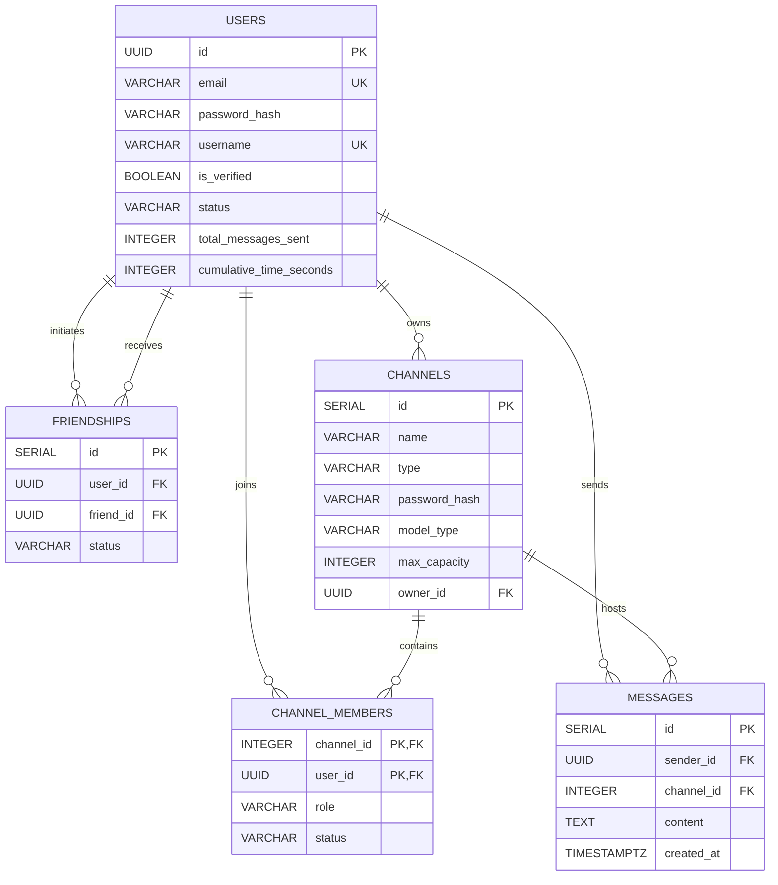

_This project has been created as part of the 42 curriculum by juljin, ksilvest, nlienard, dinza-cr._

# ft_transcendence

## Description
**[TBD - Project Name]** is a web-based **3D Coworking and Study Space**. We built this project to provide a collaborative virtual environment where users can work together in real-time. The core features include an interactive 3D room, a live chat system, user profiles with friend management, third-party OAuth logins, and an integrated AI chatbot to help answer questions while you study.

## Modules

### Web
- **[Major - 2pts] Frameworks: Next.js and FastAPI**
  - *Justification:* Chosen to establish a robust, decoupled architecture.
  - *Implementation:* Next.js (React) for the frontend UI and Python FastAPI for the AI microservice.
  - *Team:* nlienard, ksilvest
- **[Major - 2pts] Real-time WebSockets**
  - *Justification:* Essential for synchronizing user presence in the 3D space.
  - *Implementation:* Built a Go WebSocket hub using the Gorilla library to broadcast spatial data.
  - *Team:* juljin
- **[Major - 2pts] User Interaction**
  - *Justification:* Necessary to build a community-driven platform.
  - *Implementation:* Engineered a live chat, profile CRUD, and a bidirectional Postgres friendship system.
  - *Team:* juljin, nlienard

### User Management
- **[Major - 2pts] Standard Authentication**
  - *Justification:* Required to securely isolate user data and sessions.
  - *Implementation:* Developed a secure JWT architecture with Resend API email verification and avatar uploads.
  - *Team:* juljin, nlienard
- **[Minor - 1pt] Remote Authentication (OAuth 2.0)**
  - *Justification:* Chosen to provide frictionless onboarding for new users.
  - *Implementation:* Built a dynamic, state-protected OAuth pipeline for 42 Intra, Google, and GitHub.
  - *Team:* juljin

### Artificial Intelligence
- **[Major - 2pts] LLM Interface**
  - *Justification:* To provide users with an interactive, on-demand study assistant.
  - *Implementation:* Created a Python streaming API powered by the Google Gemini SDK.
  - *Team:* ksilvest
- **[Major - 2pts] Retrieval-Augmented Generation (RAG)**
  - *Justification:* Ground AI responses in contextual workspace data using pgvector semantic search.
  - *Implementation:* Built a RAG pipeline utilizing pgvector for vector cosine search and dataset export.
  - *Team:* ksilvest

### Gaming & User Experience
- **[Major - 2pts] Advanced 3D Graphics**
  - *Justification:* Chosen to foster collaboration over competition. Demonstrates severe technical complexity via WebGL lifecycle management.
  - *Implementation:* Designed custom Blender `.glb` assets, rendered via native Three.js inside React with interactive raycasting.
  - *Team:* dinza-cr

## Features List
* **Authentication:** Secure JWT-based session management, Resend Email Verification, and robust Multi-Provider OAuth 2.0 (Google, GitHub, 42 Intra) featuring a smart auto-incrementing username resolver for collision prevention. *(By juljin, nlienard)*
* **Real-Time Presence & Chat:** Gorilla WebSocket architecture with Ping/Pong heartbeats, real-time presence tracking (ONLINE/OFFLINE), Ghost-Avatar auto-cleanup, and spatial anti-cheat DB validation. *(By juljin, nlienard)*
* **Direct Messaging:** Private, omnipresent 1-on-1 chats elegantly architected on top of the existing spatial channel infrastructure. *(By juljin, nlienard)*
* **User Management:** Full CRUD operations for user profiles, settings, and avatars. *(By juljin, nlienard)*
* **Social Network:** Bidirectional friend request system (Add, Accept, Deny, Remove). *(By juljin, nlienard)*
* **AI Assistant:** Integration of a real-time, streaming conversational agent powered by the Google Gemini SDK. *(By ksilvest)*
* **3D Workspace:** An interactive 3D virtual environment built with native Three.js, featuring custom `.glb` models, interactive raycasting, smooth mouse-follow camera mechanics, and dynamic React window UI overlays for 3D object click interactions. *(By dinza-cr)*

## Instructions

### Prerequisites
Before running the project, ensure you have the following software installed:
* **Docker** (v24.0 or higher)
* **Docker Compose** (v2.0 or higher)
* **Git**

### Installation & Configuration
1. Clone the repository and navigate into it:
   ```bash
   git clone <repository_url>
   cd ft_transcendence
   ```
2. Copy the environment template:
   ```bash
   cp .env.example .env
   ```
3. Fill in the required credentials inside `.env`:
   * **Database:** Set a secure `POSTGRES_USER` and `POSTGRES_PASSWORD`.
   * **AI Chatbot:** Provide a `GOOGLE_API_KEY` for the Gemini SDK.
   * **Email Verification:** Provide a `RESEND_API_KEY`.
   * **OAuth Providers (If testing remote login):** Provide Client IDs and Secrets for Google, GitHub, and 42 Intra.

### Execution
1. Boot the entire infrastructure:
   ```bash
   make up
   ```
   *(Alternatively, run `docker compose up --build -d`)*
2. Open your browser and navigate to **`https://localhost`**.
   > *Note: Because we use self-signed SSL certificates, your browser will warn you that the connection is not private. Click "Advanced" -> "Proceed to localhost".*

## Technical Stack
* **Frontend:** Next.js (React), TypeScript, Tailwind CSS
  * *Justification:* Next.js was chosen for its App Router architecture and built-in API proxying, allowing us to safely route authenticated requests into our internal Docker network without exposing ports.
* **Frontend (3D):** Native Three.js
  * *Justification:* Native Three.js was strictly chosen over abstraction wrappers (like React Three Fiber) to maintain absolute, low-level control over the WebGL rendering lifecycle, memory management, and garbage collection during React unmounts.
* **Backend:** Go (1.27.1), net/http standard library, Gorilla WebSockets
  * *Justification:* Go was strictly chosen for its concurrency model (Goroutines), which allows us to efficiently manage hundreds of simultaneous real-time WebSocket connections and ping/pong heartbeats with virtually zero latency.
* **Backend (AI Service):** Python 3.12, FastAPI, Google GenAI SDK
  * *Justification:* Python is the industry standard for AI. FastAPI provides asynchronous request handling (`async/await`), which is crucial for streaming large LLM text chunks back to the user in real-time.
* **Database:** PostgreSQL 18, pgx/v5 driver
  * *Justification:* PostgreSQL was chosen for its unmatched ACID compliance and advanced relational indexing. Because our app relies on a complex Bidirectional Friendship system and strict spatial anti-cheat validations, we required a rigid, schema-enforced relational database rather than a NoSQL document store.
* **Third-Party APIs:** Resend Go SDK, Google Gemini API
* **Infrastructure:** Docker, Docker Compose, NGINX (HTTPS Reverse Proxy)
* **Testing:** Pytest & HTTPX (Unit testing for AI service)
* **CI/CD:** GitHub Actions (Automated Go formatting and builds)

## Database Schema
Our database utilizes a Domain-Driven Design approach with strict constraints to ensure data integrity.

* **Users Table:** Stores user profiles and authentication data. Primary key is a `UUID`. Key fields include `username` (VARCHAR, Unique), `email` (VARCHAR, Unique), and `status` (VARCHAR).
* **Friendships Table:** Manages the social network. Uses a custom Bidirectional Unique Index (`LEAST/GREATEST`) on `user_id` and `friend_id` (both UUID Foreign Keys) to elegantly handle overlapping friend requests and race conditions.
* **Channels Table:** Represents the 3D Coworking spaces. Primary key is a `SERIAL id`. Key fields include `name` (VARCHAR) and `owner_id` (UUID Foreign Key).
* **Channel_Members Table:** A junction table tracking who is currently sitting in a 3D room. Uses a composite primary key (`channel_id`, `user_id`) and tracks permissions via the `role` field.
* **Messages Table:** Stores the real-time chat history for each channel, mapping `sender_id` (UUID) to `channel_id` (INTEGER).



## Team Information
* **juljin (Tech Lead & Backend Developer)**
  * *Responsibilities:* Led the backend architecture, database schema design, and oversaw the Docker DevOps infrastructure and security (OAuth, HTTPS).
* **ksilvest (Product Owner & AI Developer)**
  * *Responsibilities:* Defined the product vision for the AI integrations, managed the Gemini SDK implementation, and developed the Python microservice.
* **nlienard (Project Manager & Frontend Developer)**
  * *Responsibilities:* Facilitated team communication and sprint goals. Architected the Next.js frontend, global state management, and user interface.
* **dinza-cr (Developer & 3D Artist)**
  * *Responsibilities:* Designed the interactive 3D Coworking assets in Blender and integrated the WebGL rendering pipeline using React Three Fiber.

## Project Management
* **Task Distribution & Organization:** The project was divided into autonomous modules (Frontend, Backend, AI, 3D). We held weekly sync meetings to align on API contracts and Docker infrastructure changes before merging feature branches into `main`.
* **Project Management Tools:** We utilized **GitHub Issues** and **GitHub Pull Requests** to track feature progress, document architectural decisions, and conduct peer code reviews. We also used **GitHub Actions** for CI/CD checks.
* **Communication Channels:** We used a dedicated **Slack** workspace for rapid, day-to-day asynchronous communication, debugging, and sharing technical documentation.

## Individual Contributions

### juljin (Backend Architecture & DevOps)
* **Contributions:** Architected the entire Go backend utilizing Gorilla WebSockets for real-time presence. Engineered the complete Multi-Provider OAuth 2.0 pipeline (42, Google, GitHub) and constructed the secure NGINX HTTPS reverse proxy network.
* **Challenges Overcome:** Engineering a bulletproof backend that gracefully handles deep edge cases. Overcame this by implementing strict cryptographic CSRF validation to prevent replay attacks, type-safe API parsing to handle malformed OAuth payloads, and a highly resilient Gorilla WebSocket architecture that seamlessly manages network latency, dropped connections, and Ghost-Avatar cleanup.

### ksilvest (AI Service Architecture & Infrastructure)
* **Contributions:** Developed the standalone Python 3.12 FastAPI microservice that powers the real-time AI Assistant. Integrated the Google GenAI SDK and established comprehensive unit testing using Pytest and HTTPX.
* **Challenges Overcome:** [TBD - Detail any bugs or architectural hurdles faced during development]

### nlienard (Frontend Architecture & UI/UX)
* **Contributions:** Bootstrapped the Next.js application utilizing Tailwind CSS and strict TypeScript. Engineered the global React Auth Context, the API Gateway proxy layer, and the responsive authentication UI modals.
* **Challenges Overcome:** [TBD - Detail any UI/UX or API integration challenges faced during development]

### dinza-cr (3D Modeling & Three.js Integration)
* **Contributions:** Designed the custom `.glb` 3D Coworking and Study Space environments in Blender. Implemented `ThreeScene.tsx` using native Three.js, engineering smooth mouse-follow camera mechanics, and dynamic React window UI overlays for 3D object click interactions.
* **Challenges Overcome:** [TBD - Detail any rendering, performance, or asset management challenges faced during development]

## Resources
### AI Usage Disclosure
AI tools were strictly used as learning aids. Specifically:
* **Research & Brainstorming:** AI was used to understand complex documentation (e.g., deciphering OAuth 2.0 handshake flows and Three.js memory management).
* **Code Review:** Used to spot-check for potential race conditions in Go Goroutines.
No core logic was blindly copy-pasted; all AI-assisted code was thoroughly peer-reviewed, heavily modified, and is fully understood by the team.

### References
* [Official Go Documentation](https://go.dev/learn/)
* [Google Gemini API Key Documentation](https://ai.google.dev/gemini-api/docs/api-key)
* [Retrieval-Augmented Generation (RAG) - Real Python](https://realpython.com/ref/ai-coding-glossary/retrieval-augmented-generation/)
* [Google OAuth 2.0 Documentation](https://developers.google.com/identity/protocols/oauth2)
* [GitHub OAuth Apps Documentation](https://docs.github.com/en/apps/oauth-apps/building-oauth-apps/authorizing-oauth-apps)
* [42 Intra API Documentation](https://api.intra.42.fr/apidoc)
